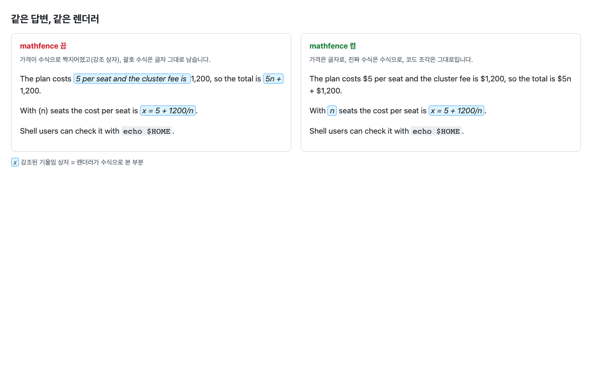
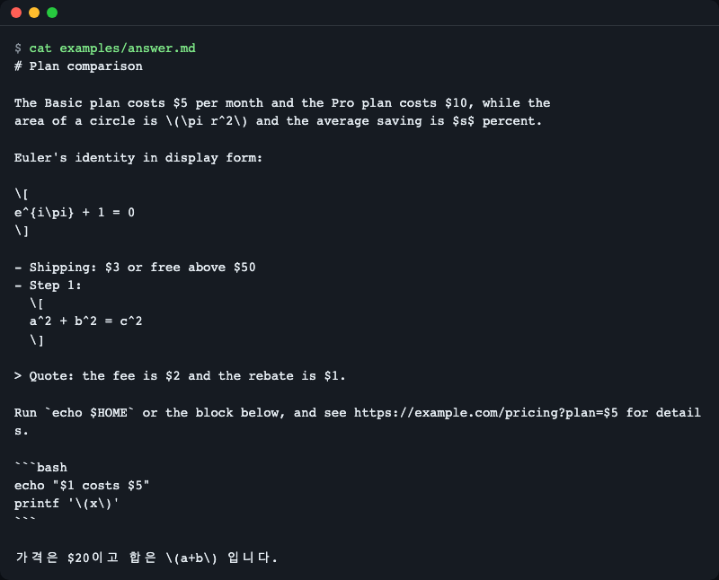
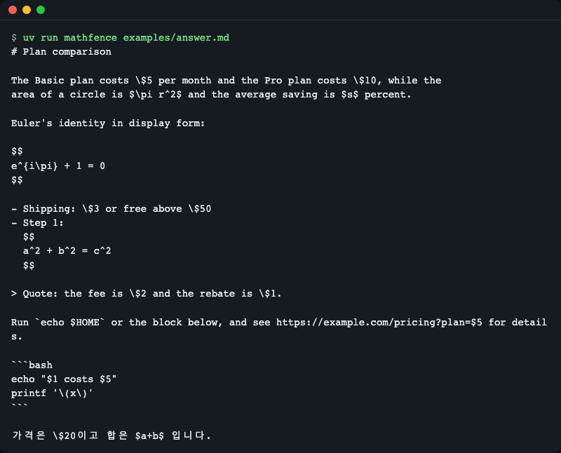
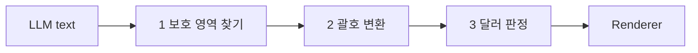
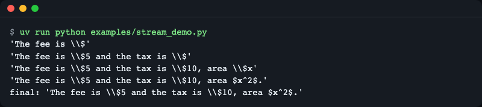
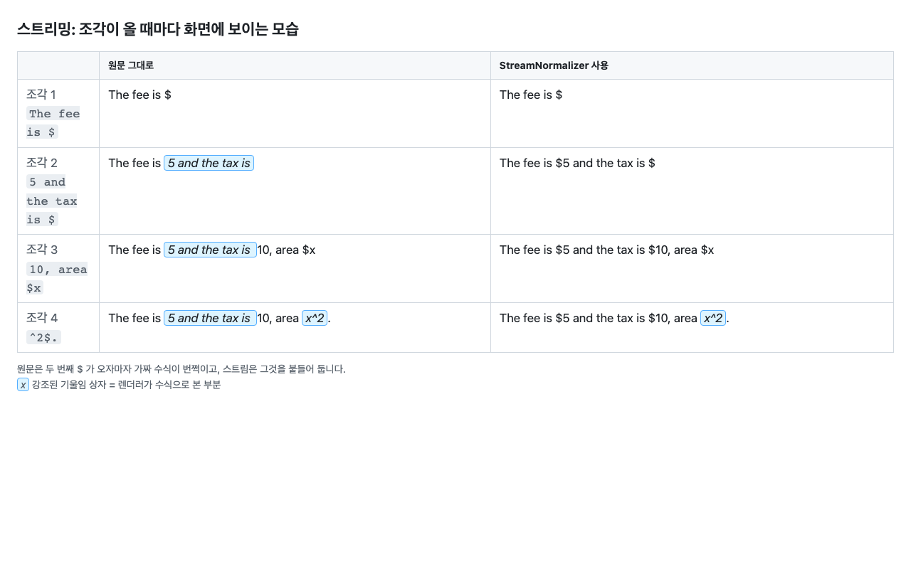
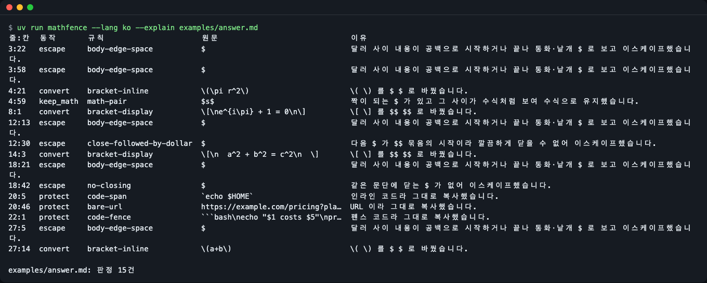
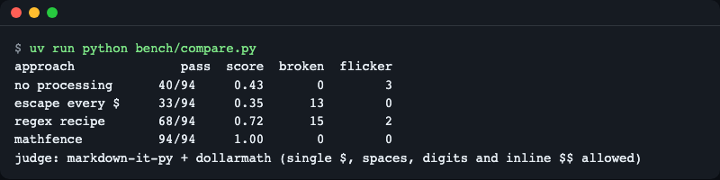

# mathfence

[English](README.md) | **한국어**

LLM 마크다운을 `$` 수식 렌더러에 넘기기 전에 고칩니다. `mathfence.normalize(text)` 한 번으로 `\( \)`·`\[ \]` 를 `$ $`·`$$ $$` 로 바꾸고, 가격 달러(`$5`)는 `\$` 로 이스케이프하며, 코드·URL·HTML 은 건드리지 않습니다. 스트리밍 도우미는 아직 덜 끝난 답변이 가짜 수식으로 깜빡이는 것을 막습니다. 파이썬 표준 라이브러리만 쓰고(런타임 의존성 0), 판정마다 이유를 설명하는 CLI 가 함께 들어 있습니다.



*왼쪽: `$5 ... $1,200` 같은 가격이 가짜 수식(강조 상자)으로 짝지어지고 `\(n\)` 은 글자 그대로 남습니다. 오른쪽: `mathfence.normalize` 후에는 가격은 글자로, 수식은 수식으로, `echo $HOME` 은 그대로입니다. markdown-it-py + dollarmath 로 렌더했고, `examples/render_compare.py` 를 보세요.*

## 설치

```bash
uv add mathfence        # 또는: pip install mathfence
```

아직 PyPI 에 없다면 GitHub 에서 설치합니다.

```bash
uv add git+https://github.com/LeeGyeongPil/mathfence
```

Python 3.10 이상, 런타임 의존성 없음. uv 가 없다면 `curl -LsSf https://astral.sh/uv/install.sh | sh` ([uv 문서](https://docs.astral.sh/uv/)).

## 빠르게 시작하기

```python
import mathfence

print(mathfence.normalize("It costs $5 and $10, area $x^2$."))
```

```text
It costs \$5 and \$10, area $x^2$.
```

가격 두 개는 이스케이프되었습니다(그대로 두면 `5 and ` 를 수식으로 읽는 짝이 됩니다). 진짜 수식 `$x^2$` 는 남습니다.

들어 있는 샘플 답변으로 명령줄을 써 봅니다.

```bash
uv run mathfence examples/answer.md
```

먼저 입력 샘플(`cat examples/answer.md`)입니다.



*흔한 원문 답변: 가격, `\( \)`·`\[ \]` 수식, 인라인 코드, URL, 코드 블록.*

그리고 결과(렌더러에 넘어가는 텍스트)입니다.



*가격은 이스케이프, 괄호는 달러로 변환, 블록 수식은 블록으로 유지, 목록·인용 접두사 유지, `echo $HOME`·URL·펜스 코드는 그대로.*

## 핵심 개념

정규식 한 줄로는 안전하게 할 수 없어서 mathfence 는 세 단계로 일합니다.



1. **보호 영역**(펜스·들여쓰기 코드, 코드 스팬, HTML, 자동 링크, 맨 URL)을 먼저 찾아 그대로 복사합니다.
2. 그 밖의 **괄호** `\( \)`·`\[ \]` 는 제자리에서 치환하므로 목록 들여쓰기와 `> ` 인용 접두사가 유지됩니다.
3. 남은 **달러**는 같은 문단 안에서 짝을 짓습니다. 짝 사이가 수식처럼 보이면 수식으로 두고, 아니면 `\$` 로 이스케이프합니다. 애매하면 이스케이프합니다. 눈에 보이는 `$` 가 문장이 깨지는 것보다 작은 실수이기 때문입니다.

**스트리밍.** 토큰이 도착하는 동안 맨 끝의 `$` 는 수식의 시작일 수도, 가격의 끝일 수도 있습니다. `StreamNormalizer` 는 끝의 `$` 를 다음 글자가 올 때까지 보류해서, 완성된 답변에 없는 수식을 화면에 보이지 않게 합니다. 끝난 문단은 확정해 다시 처리하지 않습니다.

모든 판정에는 규칙 ID(예: `body-edge-space`, `bracket-inline`)가 있고 `--explain` 이 이를 출력합니다.

## API

| 이름 | 하는 일 | 주요 인자 | 반환 |
|---|---|---|---|
| `normalize(text, *, profile="remark")` | 구분자를 바꾸고 가격 달러를 이스케이프 | `text: str`, `profile`: `"remark"` 또는 `"streamlit"` | `str` |
| `analyze(text, *, profile="remark")` | `normalize` 와 같고 모든 판정을 함께 돌려줌 | 같음 | `Result(text, decisions, changed)` |
| `Decision` | 판정 하나: `offset`, `line`, `column`, `source`, `action`(`keep_math`·`convert`·`escape`·`protect`), `kind`, `rule` | | 불변 dataclass |
| `StreamNormalizer(*, profile="remark")` | 자라나는 답변을 정규화 | | 객체 |
| `StreamNormalizer.feed(chunk)` | 조각을 더하고 지금 보여 줄 텍스트를 반환 | `chunk: str` | `str` |
| `StreamNormalizer.finish()` | 최종 텍스트(`normalize(전체)` 와 같음), 이후 `feed()` 불가 | | `str` |
| `StreamNormalizer.stats` | `reprocessed_chars`, `committed_chars` | | `StreamStats` |
| `PROFILES` | 허용 프로필 이름 | | `("remark", "streamlit")` |

오류: `str` 이 아닌 입력은 `TypeError`, 모르는 프로필은 허용 이름을 알려 주는 `ValueError`, `finish()` 뒤 `feed()` 는 `RuntimeError`.

프로필: `remark`(기본)는 `$`·`$$` 를 읽는 모든 렌더러용이고, `streamlit` 은 `$$` 블록을 모두 자기 줄에 둡니다(목록·인용 접두사 유지).

```python
import mathfence

r = mathfence.analyze(r"Cost $5, area \(x^2\).")
print(r.text)
print(r.changed)
for d in r.decisions:
    print(d.line, d.column, d.action, d.rule)
print(mathfence.normalize(r"\[a\]", profile="streamlit"))
try:
    mathfence.normalize("x", profile="nope")
except ValueError as e:
    print(e)
try:
    mathfence.normalize(b"x")
except TypeError as e:
    print(e)
```

```text
Cost \$5, area $x^2$.
True
1 6 escape body-edge-space
1 15 convert bracket-inline
$$
a
$$
unknown profile 'nope'; choose one of: remark, streamlit
text must be str, got bytes (decode bytes with .decode('utf-8') first)
```

## 사용 예

### 1. 스트리밍 답변 (`examples/stream_demo.py`)

```python
from mathfence import StreamNormalizer

stream = StreamNormalizer()
for chunk in ["The fee is $", "5 and the tax is $", "10, area $x", "^2$."]:
    print(repr(stream.feed(chunk)))
print("final:", repr(stream.finish()))
```

```text
'The fee is \\$'
'The fee is \\$5 and the tax is \\$'
'The fee is \\$5 and the tax is \\$10, area \\$x'
'The fee is \\$5 and the tax is \\$10, area $x^2$.'
final: 'The fee is \\$5 and the tax is \\$10, area $x^2$.'
```

(`repr` 가 역슬래시를 두 개로 보여 줄 뿐, 실제 텍스트에는 `\$` 가 들어 있습니다.) 끝나지 않은 `$x` 는 `^2$` 가 도착할 때까지 글자로 보이다가 그때 수식이 됩니다. 렌더러에는 원문 대신 매 조각마다 `feed()` 의 반환값을 넘기세요.



*각 줄은 조각이 하나 더 도착한 뒤 화면에 보일 텍스트입니다.*

같은 조각을 렌더러에 넣은 모습입니다. 왼쪽 열은 원문 그대로, 오른쪽 열은 `StreamNormalizer` 를 거친 것입니다.



*조각 2 이후 원문은 이미 강조된 가짜 수식(`5 and the tax is `)을 보여 주지만, 정규화된 스트림은 가격을 글자로 유지합니다. `examples/render_compare.py` 가 만듭니다.*

### 2. 달러가 왜 유지·이스케이프됐는지 보기

```bash
uv run mathfence --lang ko --explain examples/answer.md
```



*모든 판정의 줄·칸, 동작, 규칙 ID, 원문 조각, 쉬운 이유. `protect` 행은 건드리지 않은 코드와 URL 입니다.*

`--explain --format json` 은 `decisions` 배열(`line`, `column`, `action`, `rule`, `reason` …)이 든 JSON 보고서를 출력해 도구에서 쓰기 좋습니다.

### 3. CI 에서 파일 검사

```bash
uv run mathfence --lang ko --check examples/answer.md
```

```text
examples/answer.md: 바뀔 내용이 있습니다
```

`--check` 는 바뀔 파일 이름을 출력하고 종료 코드 1 을 돌려줍니다(바뀔 것이 없으면 0, 읽을 수 없는 파일이나 잘못된 옵션이면 2).

### 4. Streamlit

`examples/streamlit_chat.py` 는 녹화한 답변을 mathfence 를 켠 채·끈 채 토큰 단위로 재생합니다. 실제 모델 호출이 아닙니다. `uv run --with streamlit streamlit run examples/streamlit_chat.py` 로 실행하고, 주소 뒤에 `?lang=ko` 를 붙이면 한국어 화면입니다. Streamlit 의 `AppTest` 로만 확인했고 브라우저에서 캡처하지 않아 그 앱의 스크린샷은 없습니다. 위의 끔/켬 비교 정적 페이지는 `uv run python examples/render_compare.py` 가 `docs/demo/*.html` 로 만듭니다.

## 설정

| 옵션·변수 | 뜻 |
|---|---|
| `--profile NAME` | `remark`(기본) 또는 `streamlit` |
| `--explain`, `--format text\|json` | 텍스트 대신 판정을 출력, 입력은 하나만 |
| `--check` | 바뀔 파일을 출력하고 있으면 종료 코드 1 |
| `--lang en\|ko`, `MATHFENCE_LANG` | 메시지 언어. 우선순위 `--lang` > `MATHFENCE_LANG` > `LC_ALL` > `LC_MESSAGES` > `LANG`, 한국어가 아니면 영어 |
| FILE 또는 `-` | 입력 파일, 파일이 없거나 `-` 면 표준 입력 |

```bash
printf 'Pay $5 or $6\n' | uv run mathfence --lang en
```

```text
Pay \$5 or \$6
```

## 흔한 지름길보다 나은가?

`bench/compare.py` 는 같은 94건 말뭉치를 하나의 관대한 판정기(markdown-it-py 와 dollarmath 플러그인)로 네 가지 방식에 채점합니다.

```bash
uv run python bench/compare.py
```



*`broken` 은 훼손된 코드·URL 건수, `flicker` 는 글자 단위 스트리밍 화면 중 최종 답변에 없는 수식이 나타난 화면 수입니다.*

```text
approach              pass  score  broken  flicker
no processing      40/94     0.43       0        3
escape every $     33/94     0.35      13        0
regex recipe       68/94     0.72      15        2
mathfence          94/94     1.00       0        0
```

주의해서 읽으세요. 말뭉치는 규칙을 만든 사람이 썼기 때문에 점수는 낙관적입니다. `regex recipe` 는 흔한 스니펫을 합친 것이며 특정 프로젝트의 복제가 아닙니다.

## 언제 쓰나

- 이럴 때: 파이썬 앱(Streamlit·Gradio·Jupyter·봇 서버)이 LLM 답변을 `$`·`$$` 를 읽는 화면으로 보내는데 가격이나 `\( \)` 수식이 잘못 보일 때.
- 자바스크립트·타입스크립트 화면이라면 [remark-math](https://github.com/remarkjs/remark-math) 와 쓰는 채팅 UI 라이브러리의 마크다운 전처리 옵션을 보세요.
- 파이썬 서버에서 HTML 로 렌더링한다면 [mdit-py-plugins](https://github.com/executablebooks/mdit-py-plugins)(`dollarmath`)가 수식을 직접 파싱합니다.

## 알려진 한계

- 휴리스틱입니다. `$5 on the x$` 처럼 애매한 문장은 수식 대신 글자로 이스케이프합니다.
- `$$ ... $$`·`\[ ... \]` 안의 빈 줄은 문단을 끝내므로 그 짝은 맺어지지 않습니다.
- `StreamNormalizer` 는 코드·HTML·목록 밖의 빈 줄과, 확정할 구간에 `$`·역슬래시가 없을 때의 최상위 목록 항목 경계에서 확정합니다. 문단 구분이 없는 그 밖의 긴 구간은 `feed()` 마다 다시 처리됩니다.
- `[text](url)` 의 링크 주소와 목록·인용 안에 중첩된 HTML 블록은 보호 영역이 아닙니다.
- 로컬에서 Python 3.11·3.13·3.15 로 테스트했고 CI 는 3.10~3.13 을 확인합니다. Gradio 프로필과 Node 교차 검증은 0.2 에서 계획 중입니다.

## 문제 해결

| 증상 | 원인 | 해결 |
|---|---|---|
| 가격이 여전히 수식으로 보임 | 렌더러 전에 `normalize` 를 거치지 않았거나 코드 스팬·코드 블록 안(일부러 보호) | 렌더링 직전에 답변 전체 문자열을 정규화 |
| `TypeError: text must be str` | 바이트를 넘김 | 먼저 `data.decode("utf-8")` |
| `ValueError: unknown profile` | 프로필 이름 오타 | `remark` 또는 `streamlit` |
| `RuntimeError: feed() called after finish()` | 끝난 스트림을 재사용 | 답변마다 새 `StreamNormalizer` 생성 |
| `mathfence: error: file not found` (종료 코드 2) | 경로 오류 | 경로를 확인하거나 `-` 로 표준 입력을 읽음 |
| 진짜 수식이 이스케이프됨 | 달러 안쪽 가장자리의 공백, 또는 영단어 두 개 연속 | 공백 없이 `$x^2$` 로 쓰거나 `\( \)`·`$$` 사용 |

## 버전

유의적 버전(SemVer)을 따릅니다. 0.x 동안은 마이너 버전에서 API 가 바뀔 수 있고, 변경은 [CHANGELOG.md](CHANGELOG.md)에 적습니다.

## 개발

```bash
uv sync
uv run pytest -q
uv run python bench/compare.py
```

## 라이선스

MIT.
