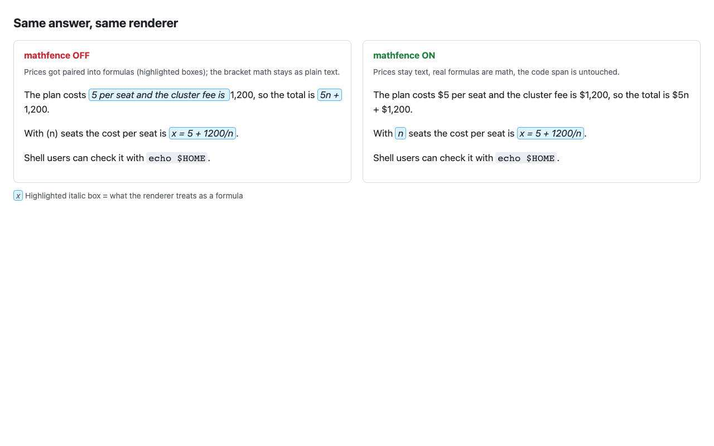
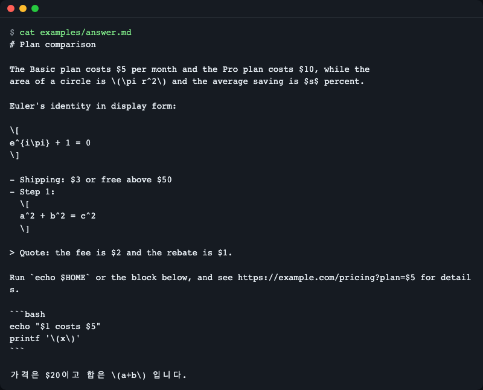
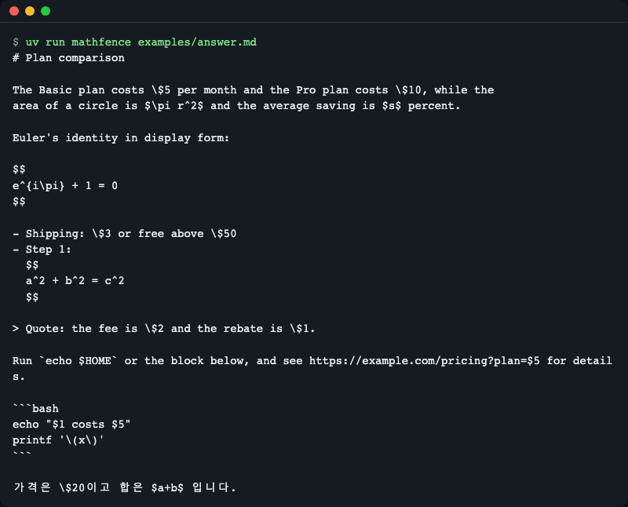
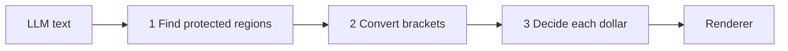
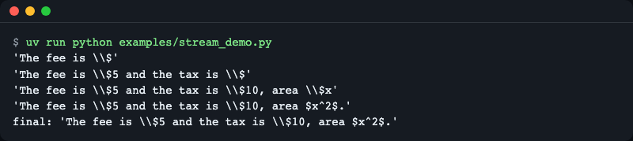
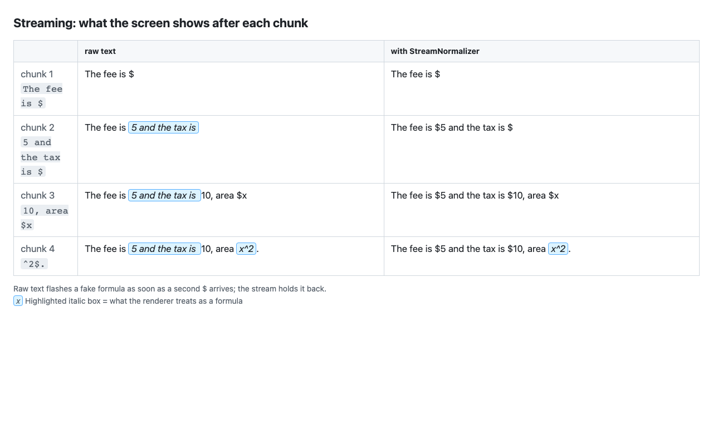
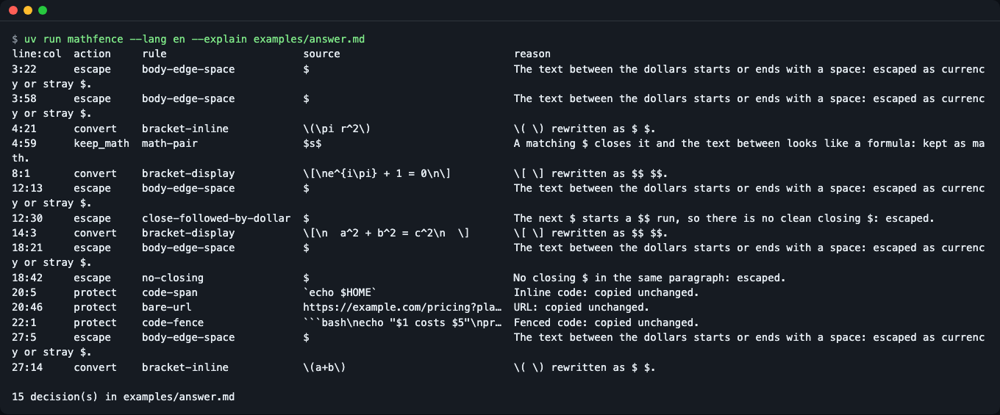
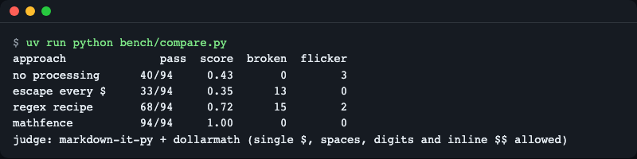

# mathfence

**English** | [한국어](README.ko.md)

Normalize LLM Markdown before it reaches a `$`-math renderer. One call, `mathfence.normalize(text)`, rewrites `\( \)` and `\[ \]` to `$ $` and `$$ $$`, escapes price dollars (`$5`) as `\$`, and leaves code, URLs and HTML untouched. A streaming helper keeps half-finished answers from flashing fake formulas. Pure Python standard library, zero runtime dependencies, plus a CLI that explains every decision.



*Left: prices such as `$5 ... $1,200` are paired into fake formulas (highlighted boxes) and `\(n\)` stays literal. Right: after `mathfence.normalize`, prices stay text, formulas render, `echo $HOME` is untouched. Rendered by markdown-it-py + dollarmath, see `examples/render_compare.py`.*

## Install

```bash
uv add mathfence        # or: pip install mathfence
```

Not on PyPI yet when you read this? Install from GitHub:

```bash
uv add git+https://github.com/LeeGyeongPil/mathfence
```

Python 3.10 or newer, no runtime dependencies. If you do not have uv: `curl -LsSf https://astral.sh/uv/install.sh | sh` ([uv docs](https://docs.astral.sh/uv/)).

## Quick start

```python
import mathfence

print(mathfence.normalize("It costs $5 and $10, area $x^2$."))
```

```text
It costs \$5 and \$10, area $x^2$.
```

The two prices are escaped (they would otherwise pair up as the formula `5 and `). The real formula `$x^2$` stays.

Try the command line on the bundled sample answer:

```bash
uv run mathfence examples/answer.md
```

The sample input first (`cat examples/answer.md`):



*A typical raw answer: prices, `\( \)` and `\[ \]` math, an inline code span, a URL and a code block.*

Then the result (the text that goes to your renderer):



*Prices escaped, brackets converted to dollars, display math kept as a block, list and quote prefixes kept, `echo $HOME`, the URL and the fenced block untouched.*

## Core concepts

A single regex cannot do this safely, so mathfence works in three steps.



1. **Protected regions** (fenced and indented code, code spans, HTML, autolinks, bare URLs) are found first and copied unchanged.
2. **Brackets** `\( \)` and `\[ \]` outside those regions are replaced in place, so list indentation and `> ` quote prefixes survive.
3. **Dollars** left over are paired inside the same paragraph. If the text between a pair looks like a formula it stays math, otherwise the `$` is escaped as `\$`. When in doubt it escapes, because a visible `$` is a smaller mistake than a broken sentence.

**Streaming.** While tokens arrive, a final `$` may be the start of a formula or the end of a price. `StreamNormalizer` holds a trailing `$` until the next character arrives, so the screen never shows math the finished answer does not contain. It also settles finished paragraphs so they are not processed again.

Every decision has a rule id (for example `body-edge-space`, `bracket-inline`), which is what `--explain` prints.

## API

| Name | What it does | Main arguments | Returns |
|---|---|---|---|
| `normalize(text, *, profile="remark")` | Rewrites delimiters and escapes currency dollars | `text: str`; `profile`: `"remark"` or `"streamlit"` | `str` |
| `analyze(text, *, profile="remark")` | Same as `normalize`, plus every decision | same | `Result(text, decisions, changed)` |
| `Decision` | One decision: `offset`, `line`, `column`, `source`, `action` (`keep_math`, `convert`, `escape`, `protect`), `kind`, `rule` | | frozen dataclass |
| `StreamNormalizer(*, profile="remark")` | Normalizes a growing answer | | object |
| `StreamNormalizer.feed(chunk)` | Adds a chunk; returns the text to show now | `chunk: str` | `str` |
| `StreamNormalizer.finish()` | Final text, equal to `normalize(all text)`; no `feed()` after it | | `str` |
| `StreamNormalizer.stats` | `reprocessed_chars`, `committed_chars` | | `StreamStats` |
| `PROFILES` | Allowed profile names | | `("remark", "streamlit")` |

Errors: a non-`str` input raises `TypeError`, an unknown profile raises `ValueError` that lists the allowed names, `feed()` after `finish()` raises `RuntimeError`.

Profiles: `remark` (default) works for any renderer that reads `$` and `$$`; `streamlit` also puts every `$$` block on its own lines (list and quote prefixes kept).

```python
import mathfence

r = mathfence.analyze(r"Cost $5, area \(x^2\).")
print(r.text)
print(r.changed)
for d in r.decisions:
    print(d.line, d.column, d.action, d.rule)
print(mathfence.normalize(r"\[a\]", profile="streamlit"))
try:
    mathfence.normalize("x", profile="nope")
except ValueError as e:
    print(e)
try:
    mathfence.normalize(b"x")
except TypeError as e:
    print(e)
```

```text
Cost \$5, area $x^2$.
True
1 6 escape body-edge-space
1 15 convert bracket-inline
$$
a
$$
unknown profile 'nope'; choose one of: remark, streamlit
text must be str, got bytes (decode bytes with .decode('utf-8') first)
```

## Usage

### 1. Streaming answers (`examples/stream_demo.py`)

```python
from mathfence import StreamNormalizer

stream = StreamNormalizer()
for chunk in ["The fee is $", "5 and the tax is $", "10, area $x", "^2$."]:
    print(repr(stream.feed(chunk)))
print("final:", repr(stream.finish()))
```

```text
'The fee is \\$'
'The fee is \\$5 and the tax is \\$'
'The fee is \\$5 and the tax is \\$10, area \\$x'
'The fee is \\$5 and the tax is \\$10, area $x^2$.'
final: 'The fee is \\$5 and the tax is \\$10, area $x^2$.'
```

(`repr` doubles the backslash; the text itself contains `\$`.) The unfinished `$x` is shown as text until `^2$` arrives, then it becomes math. Pass `feed()`'s return value to your renderer on every chunk, instead of the raw text.



*Each line is what the screen would show after one more chunk.*

The same chunks through the renderer, raw text on the left column and `StreamNormalizer` on the right:



*After chunk 2 the raw text already shows a highlighted fake formula (`5 and the tax is `); the normalized stream still shows the prices as text. Generated by `examples/render_compare.py`.*

### 2. See why a dollar was kept or escaped

```bash
uv run mathfence --lang en --explain examples/answer.md
```



*Line and column, action, rule id, the original fragment and a plain-language reason for every decision. `protect` rows are code and URLs that were left alone.*

`--explain --format json` prints a JSON report with a `decisions` array (`line`, `column`, `action`, `rule`, `reason`, ...), handy for tools.

### 3. Check files in CI

```bash
uv run mathfence --lang en --check examples/answer.md
```

```text
examples/answer.md: would change
```

`--check` prints the files that would change and exits with 1 (0 when nothing would change, 2 for an unreadable file or bad option).

### 4. Streamlit

`examples/streamlit_chat.py` replays recorded answers token by token with and without mathfence. It is not a live model call. Run it with `uv run --with streamlit streamlit run examples/streamlit_chat.py` (open with `?lang=ko` for the Korean screen). It was exercised with Streamlit's `AppTest` only, not captured in a browser, so there is no screenshot of that app. The static before/after pages above come from `uv run python examples/render_compare.py` (writes `docs/demo/*.html`).

## Settings

| Option / variable | Meaning |
|---|---|
| `--profile NAME` | `remark` (default) or `streamlit` |
| `--explain`, `--format text\|json` | Print decisions instead of the text; one input only |
| `--check` | Print files that would change, exit 1 if any |
| `--lang en\|ko`, `MATHFENCE_LANG` | Message language. Priority: `--lang` > `MATHFENCE_LANG` > `LC_ALL` > `LC_MESSAGES` > `LANG`; anything not Korean falls back to English |
| FILE or `-` | Input files; no file or `-` reads standard input |

```bash
printf 'Pay $5 or $6\n' | uv run mathfence --lang en
```

```text
Pay \$5 or \$6
```

## Does it do better than the usual shortcuts?

`bench/compare.py` scores four approaches on the same 94-case corpus with one lenient judge (markdown-it-py with its dollarmath plugin):

```bash
uv run python bench/compare.py
```



*`broken` counts code or URL text that was damaged. `flicker` counts character-by-character screens that showed a formula the final answer does not contain.*

```text
approach              pass  score  broken  flicker
no processing      40/94     0.43       0        3
escape every $     33/94     0.35      13        0
regex recipe       68/94     0.72      15        2
mathfence          94/94     1.00       0        0
```

Read this with care: the corpus was written by the author of the rules, so the score is optimistic. `regex recipe` is a composite of common snippets, not a copy of any project.

## When to use it

- Good fit: a Python app (Streamlit, Gradio, Jupyter, a bot server) sends LLM answers to a front end that reads `$` and `$$`, and prices or `\( \)` math show up wrongly.
- JavaScript or TypeScript front end: look at [remark-math](https://github.com/remarkjs/remark-math) and the markdown preprocessing options of your chat UI library instead.
- Server-side HTML rendering in Python: [mdit-py-plugins](https://github.com/executablebooks/mdit-py-plugins) (`dollarmath`) parses math itself.

## Known limits

- It is a heuristic. An ambiguous sentence such as `$5 on the x$` is escaped (shown as text) rather than rendered as math.
- A blank line inside `$$ ... $$` or `\[ ... \]` ends the paragraph, so that pair is not matched.
- `StreamNormalizer` settles text at blank lines outside code, HTML and lists, and at top-level list item boundaries when the settled part has no `$` or backslash; other long runs without paragraph breaks are reprocessed on every `feed()`.
- Link destinations in `[text](url)` and HTML blocks nested in lists or quotes are not protected regions.
- Tested on Python 3.11, 3.13 and 3.15 locally; CI covers 3.10 to 3.13. The Gradio profile and a Node cross-check are planned for 0.2.

## Troubleshooting

| Symptom | Cause | Fix |
|---|---|---|
| A price still renders as math | The text was not passed through `normalize` before the renderer, or it is inside a code span or code block (protected on purpose) | Normalize the whole answer string right before rendering |
| `TypeError: text must be str` | Bytes were passed | `data.decode("utf-8")` first |
| `ValueError: unknown profile` | Misspelled profile | Use `remark` or `streamlit` |
| `RuntimeError: feed() called after finish()` | Reused a finished stream | Create a new `StreamNormalizer` per answer |
| `mathfence: error: file not found` (exit 2) | Wrong path | Check the path, or pass `-` to read standard input |
| A real formula was escaped | Spaces just inside the dollars, or two plain words in a row | Write `$x^2$` without edge spaces, or use `\( \)` / `$$` |

## Versions

Semantic Versioning. While the major version is 0, a minor release may change the API; changes are listed in [CHANGELOG.md](CHANGELOG.md).

## Development

```bash
uv sync
uv run pytest -q
uv run python bench/compare.py
```

## License

MIT.
